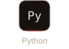
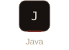
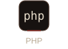
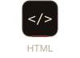
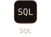
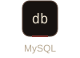
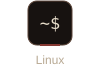
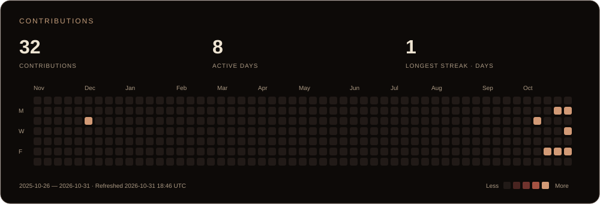

  

<strong>Web security &middot; Scripting &middot; APIs</strong>

  <a href="#about-me">About me</a> &nbsp; / &nbsp;
  <a href="#technology-toolbox">Technology toolbox</a> &nbsp; / &nbsp;
  <a href="#github-activity">GitHub activity</a>

## About me

**Web security, automation, and API development.**

Application security across authentication, access control, input handling, and data exposure. Working knowledge of HTTP, server-side logic, and database interactions supports both development and security analysis.

Scripting for automation, service integration, and data processing. Technical stack: Python, Java, PHP, SQL, and Linux.

## Technology toolbox

<strong>Languages</strong>

  
  
  
  
  

<strong>Systems &amp; tools</strong>

  
  

## GitHub activity

  

